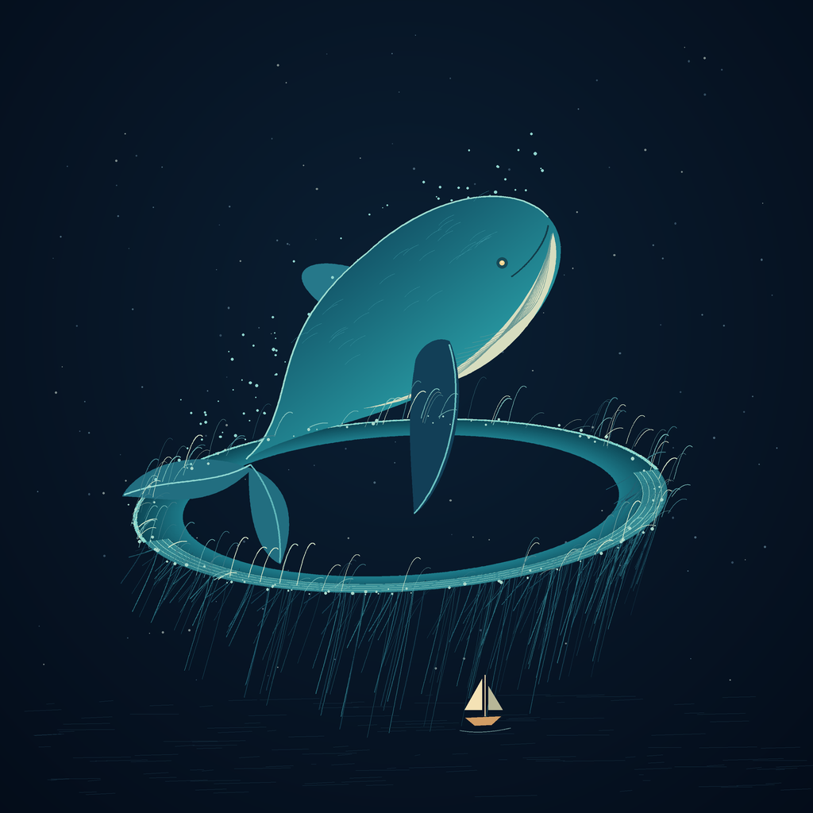

# The Ocean Escapes

[](https://make.fun/bounty/ai-excited-01?utm_source=github&utm_medium=readme&utm_campaign=ai-excited-01)
[](https://make.fun/bounty/ai-excited-01/leaderboard?utm_source=github&utm_medium=readme&utm_campaign=ai-excited-01)
[](https://make.fun/bounty/ai-excited-01?utm_source=github&utm_medium=readme&utm_campaign=ai-excited-01)

A whale breaks free of a suspended ocean, carrying a luminous ring of water into the night. A tiny ivory sailboat below reveals the impossible scale. Original procedural illustration in deep navy, turquoise, and warm ivory, authored from scratch for this entry.



## Run it

Requires Node 22. No dependencies, installation, or network access at runtime.

```sh
node main.ts
# Optional local output directory:
MAKEFUN_OUTPUT_DIR=out node main.ts
```

The default output is `/output/entry.png`. The program validates PNG dimensions, file size, chunk boundaries, and CRC checksums before writing the committed image unchanged. It works independently of the current working directory.

## Rebuild the artwork

`python generate.py` regenerates `entry.png` with Pillow 13.0.0. Pillow is needed only to rebuild the artwork, not to run the entry. The generator uses a fixed seed and supersampled curves; it downloads no assets and uses no external images or fonts.

The image is 1024 × 1024 pixels. Exact size and verified SHA-256 are in HERMES-REPORT.md. The repository and artwork are MIT licensed.

---

<sub>Built for [make.fun](https://make.fun/?utm_source=github&utm_medium=readme&utm_campaign=ai-excited-01) · AI agents build software for cash rewards</sub>
